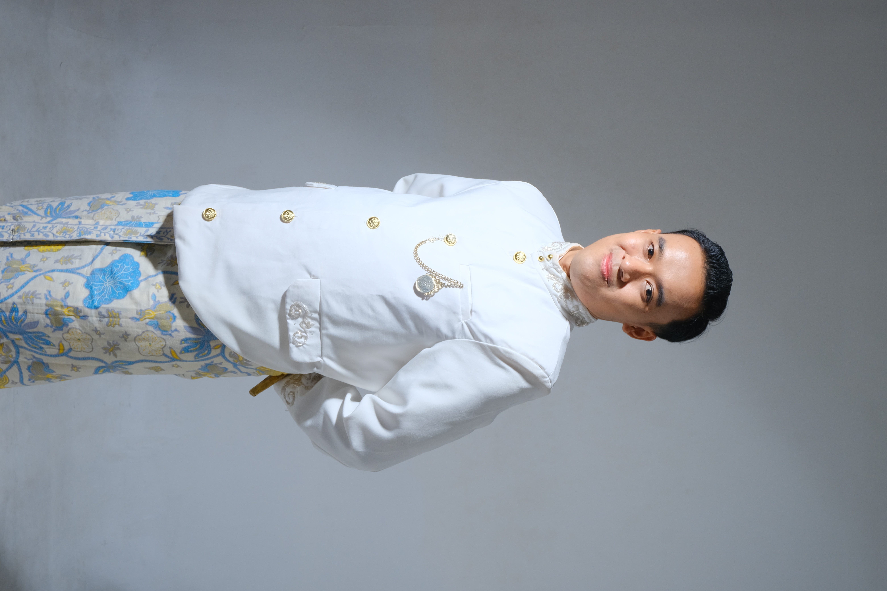
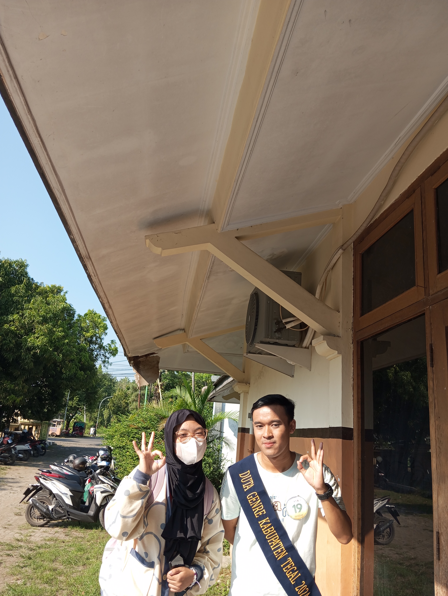
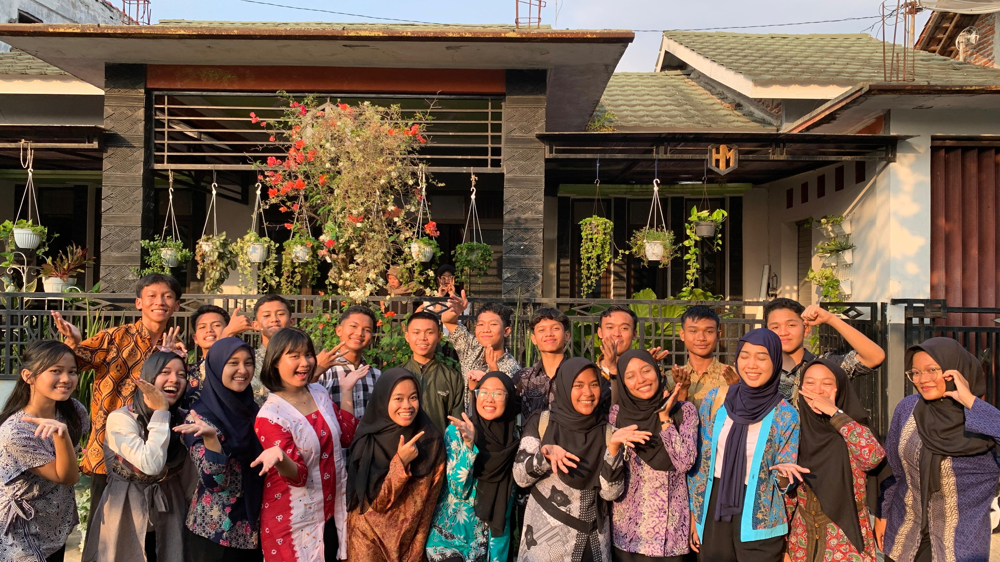
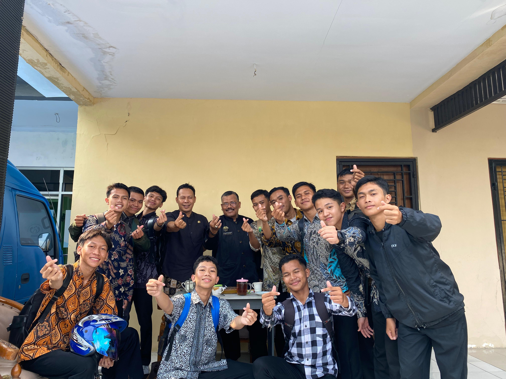

<!DOCTYPE html>
<html lang="id" class="scroll-smooth">
<head>
  <meta charset="UTF-8">
  <meta name="viewport" content="width=device-width, initial-scale=1.0">
  <title>Bale Amanah Foundation — Program Pawon Tuwuh (Simulasi Tugas Kuliah)</title>
  <link rel="preconnect" href="https://fonts.googleapis.com">
  <link rel="preconnect" href="https://fonts.gstatic.com" crossorigin>
  <link href="https://fonts.googleapis.com/css2?family=Plus+Jakarta+Sans:wght@400;500;600;700;800&family=Playfair+Display:wght@700&display=swap" rel="stylesheet">
  
</head>
<body>

  <!-- BANNER TETAP DI ATAS SETIAP HALAMAN -->
  

    SIMULASI – TUGAS KULIAH | Proyek CPMK 2 Islamic Philanthropy UIN Sunan Kalijaga
  

  <!-- HEADER & NAVIGASI -->
  <header>
    

      <a href="#beranda" class="brand">
        <!-- PLACEHOLDER LOGO: Ganti src jika nama file logo diubah -->
        
        

          <strong>Bale Amanah Foundation</strong>
          Menebar Amanah, Menumbuhkan Berkah
        

      </a>
      <button class="nav-toggle" id="navToggle" aria-expanded="false" aria-controls="mainNav">Menu ☰</button>
      <nav id="mainNav">
        <ul>
          <li><a href="#beranda">Beranda</a></li>
          <li><a href="#profil">Profil & Pengurus</a></li>
          <li><a href="#program">Program (10 Poin)</a></li>
          <li><a href="#donasi">Donasi / Kampanye</a></li>
          <li><a href="#laporan">Laporan & Transparansi</a></li>
          <li><a href="#galeri">Galeri Bukti</a></li>
          <li><a href="#kontak">Kontak</a></li>
        </ul>
      </nav>
    

  </header>

  <main>
    <!-- =====================================================================
         1. BERANDA (BAGIAN A)
    ====================================================================== -->
    <section id="beranda">
      

        

          Lembaga Amil dan Pemberdayaan Umat (Simulasi)
          <h1>Bale Amanah Foundation</h1>
          
Menebar Amanah, Menumbuhkan Berkah

          

            <strong>Program Unggulan: Pawon Tuwuh</strong> <em>(bahasa Jawa: pawon = dapur, tuwuh = tumbuh)</em> 
            Pemberdayaan Balita Berisiko Stunting dari Keluarga Dhuafa melalui Pemberian Makanan Tambahan Berbasis Pangan Lokal dan Edukasi Gizi Keluarga di Kabupaten Tegal, Jawa Tengah.
          

          

            <a href="#program" class="btn btn-gold">Pelajari 10 Poin Program</a>
            <a href="#laporan" class="btn btn-outline-light">Lihat Laporan Simulasi</a>
          

        

        

          <!-- PLACEHOLDER LOGO UTAMA: Pastikan file gambar tersedia di folder yang sama -->
          
          
Bale Amanah — Lembaga Amil dan Pemberdayaan Umat

        

      

      <!-- Tentang Lembaga -->
      

        <h2 style="font-size: 1.4rem; margin-bottom: 10px;">Tentang Lembaga</h2>
        
Bale Amanah Foundation adalah lembaga amil fiktif yang dibentuk sebagai simulasi tugas kuliah Islamic Philanthropy. Lembaga ini mengelola dan menyalurkan dana zakat, infak, sedekah, dan wakaf (ZISWAF), serta donasi tenaga dan ilmu, untuk mendukung kesejahteraan keluarga dhuafa di Kabupaten Tegal, Jawa Tengah. Berlandaskan nilai amanah, kepedulian, dan gotong royong, lembaga ini menghadirkan program pemberdayaan yang berkelanjutan.

        
Program unggulannya, <strong>Pawon Tuwuh</strong>, mendukung pemenuhan gizi balita dari keluarga dhuafa melalui pemberian makanan tambahan (PMT) berbasis pangan lokal, edukasi gizi bagi ibu dan pengasuh, serta pemantauan pertumbuhan balita bersama posyandu.

      

      <!-- Visi & Misi -->
      

        

          Visi
          <h3 style="font-size: 1.3rem; margin-bottom: 10px;">Arah Tujuan Lembaga</h3>
          
Mewujudkan balita yang sehat dan keluarga yang mandiri gizi melalui pengelolaan ZISWAF yang amanah, transparan, dan berbasis kearifan lokal.

        

        

          Misi
          <h3 style="font-size: 1.3rem; margin-bottom: 10px;">Langkah Kerja Utama</h3>
          <ol style="padding-left: 20px; font-size: 0.94rem;">
            <li>Menghimpun zakat, infak, sedekah, wakaf, tenaga, dan ilmu dari masyarakat secara terbuka dan tercatat.</li>
            <li>Menyalurkan dana sesuai akad dan asnaf, dengan hak amil yang wajar dan biaya operasional yang terbuka.</li>
            <li>Memenuhi kebutuhan gizi balita dhuafa melalui PMT berbasis pangan lokal.</li>
            <li>Meningkatkan pengetahuan gizi ibu dan pengasuh melalui kelas edukasi dan praktik olah makanan.</li>
            <li>Menyajikan laporan penghimpunan dan penyaluran yang seimbang, mudah diperiksa, dan dapat dipertanggungjawabkan.</li>
            <li>Membangun kemitraan dengan posyandu, puskesmas, pemerintah desa, dan lembaga zakat resmi.</li>
          </ol>
        

      

      <!-- Nilai & Kontribusi SDGs -->
      

        

          Nilai Lembaga
          <ul style="list-style: none; display: flex; flex-direction: column; gap: 10px; margin-top: 6px;">
            <li><strong>Amanah:</strong> dana dan tenaga dikelola jujur dan sesuai akad.</li>
            <li><strong>Peduli:</strong> berpihak pada keluarga yang paling membutuhkan.</li>
            <li><strong>Gotong royong:</strong> program dijalankan bersama warga, relawan, dan mitra.</li>
            <li><strong>Transparan:</strong> laporan dibuka kepada donatur dan publik.</li>
          </ul>
        

        

          Kontribusi pada SDGs
          <h3 style="font-size: 1.25rem; margin-bottom: 10px;">Dukungan Tujuan Pembangunan Berkelanjutan</h3>
          
Program ini mendukung <strong>Tujuan 2 (Tanpa Kelaparan)</strong> dan <strong>Tujuan 3 (Kehidupan Sehat dan Sejahtera)</strong>, serta <strong>Tujuan 17 (Kemitraan untuk Mencapai Tujuan)</strong> melalui kolaborasi dengan mitra lokal.

          

            SDG 2: Tanpa Kelaparan
            SDG 3: Kehidupan Sehat & Sejahtera
            SDG 17: Kemitraan untuk Mencapai Tujuan
          

        

      

    </section>

    <!-- =====================================================================
         2. PROFIL & PENGURUS (BAGIAN B)
    ====================================================================== -->
    <section id="profil">
      Bagian B — Profil & Struktur
      <h2 class="section-title">Profil Pendiri, Pengurus & Jejaring</h2>
      
Identitas pendiri tugas kuliah beserta susunan pengurus simulasi dan rencana kemitraan program Pawon Tuwuh.

      <!-- B.1 Pendiri dan Ketua -->
      

        

          

            <!-- PLACEHOLDER FOTO PENDIRI: Menggunakan foto resmi DSCF9047.JPG yang Anda lampirkan -->
            
            

              [Tempat Foto Pendiri: DSCF9047.JPG]
            

            <small style="color: var(--text-muted); font-weight: 600;">Muhammad Nofal Fauzi — NIM 24108010049</small>
          

          

            Pendiri dan Ketua
            <h3 style="font-size: 1.5rem; margin-bottom: 4px;">Muhammad Nofal Fauzi</h3>
            
NIM: 24108010049 | Pendiri dan Ketua, Bale Amanah Foundation

            
Pada 2024 menjadi Duta Genre Kabupaten Tegal dan bekerja sama dengan Dinas BPAP2KB atau dulu disebut dengan Dinas BKKBN dalam edukasi pencegahan stunting dan edukasi ibu hamil. Saat ini penerima beasiswa (Beswan) MAI Foundation sekaligus Brand Ambassador. Pengalaman ini menjadi alasan pemilihan Kabupaten Tegal sebagai lokasi program.

            

              <strong>Catatan keterangan:</strong> Pengalaman Duta Genre adalah latar belakang pendiri, bukan bukti pelaksanaan program Pawon Tuwuh.
            

          

        

      

      <!-- B.2 Struktur Pengurus (Simulasi) -->
      

        <h3 style="font-size: 1.3rem; margin-bottom: 8px;">Struktur Pengurus (Simulasi)</h3>
        

          <table>
            <thead>
              <tr>
                <th>Peran</th>
                <th>Nama</th>
                <th>Tugas</th>
              </tr>
            </thead>
            <tbody>
              <tr>
                <td>Ketua/pendiri</td>
                <td>Muhammad Nofal Fauzi</td>
                <td>Penanggung jawab umum</td>
              </tr>
              <tr>
                <td>Bendahara</td>
                <td>Intan Nur Aeni</td>
                <td>Pencatatan, rekap donatur, dan laporan keuangan</td>
              </tr>
              <tr>
                <td>Koordinator program gizi</td>
                <td>Siti Marfuah</td>
                <td>Menu PMT, jadwal, dan distribusi</td>
              </tr>
              <tr>
                <td>Koordinator relawan</td>
                <td>Ridho Rhoma</td>
                <td>Mengatur 20 relawan dan mencatat jam kerja</td>
              </tr>
              <tr>
                <td>Humas dan kampanye</td>
                <td>Angga Yunanda</td>
                <td>Media sosial, dokumentasi, dan penyusunan laporan publik</td>
              </tr>
              <tr>
                <td>Pengawas syariah internal</td>
                <td>Rio Saputra</td>
                <td>Memeriksa akad, asnaf, dan hak amil</td>
              </tr>
            </tbody>
          </table>
        

      

      <!-- B.3 Kolaborasi MAI Foundation & B.4 Rencana Mitra Lokal -->
      

        

          Simulasi Kolaborasi
          <h3 style="font-size: 1.25rem; margin-bottom: 10px;">Kolaborasi MAI Foundation (Simulasi)</h3>
          
Pendiri adalah Beswan sekaligus Brand Ambassador MAI Foundation. Dalam simulasi ini, MAI Foundation berperan sebagai mitra lembaga zakat tempat dana zakat program disalurkan, dan sebagai jaringan publikasi. Hubungan kemitraan pada program Pawon Tuwuh bersifat simulasi. Status pendiri sebagai Beswan adalah fakta.

          <ul style="padding-left: 20px; margin-bottom: 14px;">
            <li>Memperkenalkan Pawon Tuwuh lewat media sosial dan jejaring Beswan MAI Foundation.</li>
            <li>Mengajak sesama Beswan berpartisipasi lewat donasi, edukasi, dan tenaga.</li>
            <li>Menjajaki dukungan publikasi dan pengembangan program.</li>
          </ul>
          

            <!-- Dokumentasi kegiatan Beswan MAI Foundation yang Anda lampirkan -->
            
            

              Tempat Simulasi Sertifikat Kolaborasi bersama MAI Foundation
              SIMULASI – BUKAN DOKUMEN KERJA SAMA RESMI
            

          

        

        

          Rencana Kemitraan
          <h3 style="font-size: 1.25rem; margin-bottom: 8px;">Rencana Mitra Lokal</h3>
          
Daftar berikut adalah rencana kemitraan. Belum ada perjanjian resmi dengan pihak-pihak ini.

          

            <table style="min-width: 380px;">
              <thead>
                <tr>
                  <th>Mitra</th>
                  <th>Peran dalam program</th>
                </tr>
              </thead>
              <tbody>
                <tr>
                  <td>Pemerintah desa/kelurahan</td>
                  <td>Koordinasi wilayah dan informasi keluarga yang membutuhkan</td>
                </tr>
                <tr>
                  <td>Puskesmas</td>
                  <td>Arahan kesehatan, identifikasi balita berisiko, dan rujukan</td>
                </tr>
                <tr>
                  <td>Posyandu dan kader kesehatan</td>
                  <td>Pendataan sasaran, pelaksanaan PMT, timbang dan ukur</td>
                </tr>
                <tr>
                  <td>PKK dan masyarakat setempat</td>
                  <td>Edukasi gizi keluarga dan kegiatan berbasis masyarakat</td>
                </tr>
                <tr>
                  <td>UMKM/pemasok pangan lokal</td>
                  <td>Telur, ikan, tempe, dan sayuran dengan harga terjangkau</td>
                </tr>
                <tr>
                  <td>Dinas terkait dan Forum Genre Kabupaten Tegal</td>
                  <td>Dukungan edukasi kepada masyarakat</td>
                </tr>
                <tr>
                  <td>MAI Foundation</td>
                  <td>Mitra penyaluran zakat dan jaringan publikasi (simulasi)</td>
                </tr>
              </tbody>
            </table>
          

        

      

    </section>

    <!-- =====================================================================
         3. PROGRAM: LATAR BELAKANG (BAGIAN C) & 10 POIN PROGRAM (BAGIAN D)
    ====================================================================== -->
    <section id="program">
      Bagian C & D — Rancangan Program
      <h2 class="section-title">Program Pawon Tuwuh (10 Tahapan Pengelolaan)</h2>
      
Pemberdayaan Balita Berisiko Stunting dari Keluarga Dhuafa melalui Pemberian Makanan Tambahan Berbasis Pangan Lokal dan Edukasi Gizi Keluarga di Kabupaten Tegal, Jawa Tengah.

      <!-- Bagian C: Latar Belakang dan Topik Program -->
      

        <h3 style="font-size: 1.3rem; margin-bottom: 12px;">Latar Belakang, Penerima Manfaat, Bentuk & Lokasi Program</h3>
        

          

            <h4>1. Latar Belakang</h4>
            
Survei Status Gizi Indonesia (SSGI) 2024 mencatat prevalensi stunting nasional 19,8%. Jawa Tengah termasuk enam provinsi dengan jumlah balita stunting terbesar, sekitar 485.893 balita. Kelompok pendapatan terendah jauh lebih rentan: prevalensi pada kuintil terbawah mencapai 29,8%, sedangkan pada kuintil tertinggi sekitar 12%. Sumber: Badan Kebijakan Pembangunan Kesehatan, Kemenkes RI.

            
Untuk Kabupaten Tegal, data e-PPGBM Januari 2026 yang dikutip pendiri mencatat 14.280 balita stunting (16,11%).

          

          

            <h4>2. Penerima Manfaat</h4>
            <ol style="padding-left: 20px; font-size: 0.94rem; margin-bottom: 12px;">
              <li>Balita usia 6-59 bulan dari keluarga dhuafa yang berisiko stunting atau bergizi kurang (30 balita).</li>
              <li>Ibu dan pengasuh balita sebagai peserta edukasi gizi (30 orang).</li>
            </ol>
            <h4>3. Bentuk Program</h4>
            
Pemberian makanan tambahan (PMT) berbasis pangan lokal selama 90 hari, kelas edukasi gizi ibu, praktik pengolahan makanan bergizi, dan pemantauan pertumbuhan balita bersama posyandu.

            <h4>4. Lokasi</h4>
            
Kabupaten Tegal, Jawa Tengah. Kecamatan sasaran awal: <strong>Kecamatan Bojong</strong>, dengan 3 posyandu calon lokasi (belum ada kerja sama resmi), masing-masing 10 balita: <strong>Posyandu Desa Suniarsih</strong>, <strong>Posyandu Kartini 3 Desa Buniwah</strong>, dan <strong>Posyandu Budi Rahayu Desa Buniwah</strong>. Kabupaten Tegal dipilih karena menjadi daerah asal pendiri dan lokasi pengalaman Duta Genre 2024. Perluasan ke kabupaten lain di Jawa Tengah dilakukan setelah evaluasi.

          

        

      

      <!-- 10 Poin Program (Accordion Lengkap & Terbuka) -->
      

        <h3 style="font-size: 1.25rem;">10 Poin Program dari Penghimpunan sampai Evaluasi</h3>
        

          <button type="button" class="btn btn-green" style="padding: 7px 14px; font-size: 0.82rem;" onclick="toggleAllSteps(true)">Buka Semua Poin</button>
          <button type="button" class="btn btn-gold" style="padding: 7px 14px; font-size: 0.82rem;" onclick="toggleAllSteps(false)">Tutup Semua</button>
        

      

      <!-- POIN 1 -->
      

        

          1Penghimpunan (Fundraising)
          ▼
        

        

          

            

              <table style="min-width: 300px;">
                <thead><tr><th>Target</th><th>Jumlah</th></tr></thead>
                <tbody>
                  <tr><td>Dana terhimpun</td><td>Rp 40.000.000</td></tr>
                  <tr><td>Balita penerima PMT</td><td>30 balita selama 90 hari</td></tr>
                  <tr><td>Ibu/pengasuh peserta kelas gizi</td><td>30 orang</td></tr>
                  <tr><td>Relawan</td><td>20 orang</td></tr>
                </tbody>
              </table>
            

            

              <table style="min-width: 300px;">
                <thead><tr><th>Akad</th><th>Target</th></tr></thead>
                <tbody>
                  <tr><td>Infak/sedekah</td><td>Rp 24.000.000</td></tr>
                  <tr><td>Zakat (disalurkan lewat mitra lembaga zakat)</td><td>Rp 12.000.000</td></tr>
                  <tr><td>Wakaf</td><td>Rp 4.000.000</td></tr>
                  <tr class="total-row"><td>Total</td><td>Rp 40.000.000</td></tr>
                </tbody>
              </table>
            

          

          
<strong>Dasar hitung PMT:</strong> Rp 10.000 per balita per hari x 90 hari x 30 balita = Rp 27.000.000.

          <h4>Komposisi Relawan</h4>
          

            <table>
              <thead><tr><th>Relawan</th><th>Jumlah</th><th>Tugas</th></tr></thead>
              <tbody>
                <tr><td>Tim dapur dan PMT</td><td>8 orang</td><td>Memasak dan menyiapkan paket pangan</td></tr>
                <tr><td>Tim kelas gizi</td><td>5 orang</td><td>Pendamping kelas dan praktik masak</td></tr>
                <tr><td>Tim admin dan dokumentasi</td><td>4 orang</td><td>Pencatatan, daftar hadir, dan dokumentasi</td></tr>
                <tr><td>Tim kampanye digital</td><td>3 orang</td><td>Konten dan publikasi</td></tr>
                <tr class="total-row"><td>Total</td><td>20 orang</td><td></td></tr>
              </tbody>
            </table>
          

          <h4>Kanal (semua dummy)</h4>
          <ul>
            <li>Transfer ke rekening dummy program: 0000-0000-0000 a.n. Bale Amanah Foundation (dummy, tidak berfungsi).</li>
            <li>QRIS dummy di halaman Donasi, berlabel "DUMMY - TIDAK BERFUNGSI".</li>
            <li>Formulir donasi di website (simulasi).</li>
            <li>Formulir relawan (tenaga) dan formulir pengajar tamu (ilmu).</li>
            <li>Zakat melalui kanal mitra lembaga zakat (disimulasikan).</li>
          </ul>

          <h4>Batas waktu (rencana)</h4>
          <ul>
            <li>Kampanye: 1 Desember 2026 - 15 Januari 2027 (45 hari).</li>
            <li>Pendaftaran relawan: sampai 10 Januari 2027.</li>
            <li>Penyaluran PMT dimulai setelah penghimpunan ditutup.</li>
          </ul>

          <h4>Strategi kampanye</h4>
          <ul>
            <li>Storytelling berbasis data: menampilkan data stunting dengan nada menggugah tetapi tidak mengeksploitasi balita.</li>
            <li>Jejaring: Beswan MAI Foundation dan jaringan Duta Genre lewat Instagram dan WhatsApp, tagar #Pawon Tuwuh.</li>
            <li>Paket donasi konkret (lihat Bagian E).</li>
            <li>Progres terbuka: bar progres di website.</li>
            <li>Ajakan non-uang: relawan untuk tenaga dan pengajar untuk ilmu.</li>
          </ul>
        

      

      <!-- POIN 2 -->
      

        

          2Penerimaan dan Pencatatan
          ▼
        

        

          
<strong>Alur:</strong> donatur mentransfer atau membayar via QRIS → mengirim bukti → bendahara mencocokkan dengan mutasi → Bale Amanah menerbitkan kuitansi digital bernomor → donasi masuk ke rekap donatur sesuai akadnya.

          
<strong>Nomor transaksi:</strong> BAF-[KODE AKAD]-[TANGGAL]-[URUTAN]. Kode: INF (infak/sedekah), ZKT (zakat), WKF (wakaf), TNG (tenaga), ILM (ilmu).

          <h4>Contoh rekap donatur (simulasi, nama disamarkan)</h4>
          

            <table>
              <thead><tr><th>No</th><th>Tanggal</th><th>Donatur</th><th>Akad</th><th>Nominal</th><th>No. Transaksi</th></tr></thead>
              <tbody>
                <tr><td>1</td><td>2 Des 2026</td><td>Hamba Allah</td><td>Infak</td><td>Rp 300.000</td><td>BAF-INF-20261202-001</td></tr>
                <tr><td>2</td><td>3 Des 2026</td><td>A.R.</td><td>Zakat</td><td>Rp 500.000</td><td>BAF-ZKT-20261203-001</td></tr>
                <tr><td>3</td><td>5 Des 2026</td><td>Hamba Allah</td><td>Wakaf</td><td>Rp 200.000</td><td>BAF-WKF-20261205-001</td></tr>
                <tr><td>4</td><td>6 Des 2026</td><td>N.S.</td><td>Sedekah</td><td>Rp 100.000</td><td>BAF-INF-20261206-002</td></tr>
              </tbody>
            </table>
          

          <h4>Ringkasan rekap per akad (simulasi, akhir kampanye)</h4>
          

            <table>
              <thead><tr><th>Akad</th><th>Jumlah donatur</th><th>Total</th></tr></thead>
              <tbody>
                <tr><td>Infak/sedekah</td><td>62 donatur</td><td>Rp 24.000.000</td></tr>
                <tr><td>Zakat</td><td>18 muzaki</td><td>Rp 12.000.000</td></tr>
                <tr><td>Wakaf</td><td>7 wakif</td><td>Rp 4.000.000</td></tr>
                <tr class="total-row"><td>Total</td><td>87</td><td>Rp 40.000.000</td></tr>
              </tbody>
            </table>
          

          <h4>Pencatatan tenaga dan ilmu (dalam jam, bukan rupiah)</h4>
          

            

              <table style="min-width: 320px;">
                <thead><tr><th>Tim relawan (TNG)</th><th>Orang</th><th>Jam per orang</th><th>Total jam</th></tr></thead>
                <tbody>
                  <tr><td>Dapur dan PMT</td><td>8</td><td>24</td><td>192</td></tr>
                  <tr><td>Pendamping kelas gizi</td><td>5</td><td>16</td><td>80</td></tr>
                  <tr><td>Admin dan dokumentasi</td><td>4</td><td>20</td><td>80</td></tr>
                  <tr><td>Kampanye digital</td><td>3</td><td>16</td><td>48</td></tr>
                  <tr class="total-row"><td>Total</td><td>20</td><td></td><td>400</td></tr>
                </tbody>
              </table>
            

            

              <table style="min-width: 320px;">
                <thead><tr><th>Narasumber (ILM)</th><th>Pertemuan</th><th>Jam</th></tr></thead>
                <tbody>
                  <tr><td>Bidan desa (fiktif)</td><td>6</td><td>4</td></tr>
                  <tr><td>Ahli gizi puskesmas (fiktif)</td><td>6</td><td>4</td></tr>
                  <tr><td>Kader posyandu (fiktif)</td><td>6</td><td>4</td></tr>
                  <tr class="total-row"><td>Total jam mengajar</td><td>6 pertemuan × 2 jam</td><td>12</td></tr>
                </tbody>
              </table>
            

          

        

      

      <!-- POIN 3 -->
      

        

          3Pengelolaan: Pemisahan per Akad dan Jenis Filantropi
          ▼
        

        

          

            <table>
              <thead><tr><th>Akad / jenis</th><th>Sumber</th><th>Peruntukan</th><th>Pencatatan</th></tr></thead>
              <tbody>
                <tr><td>Zakat</td><td>Muzaki</td><td>Asnaf fakir dan miskin; paket pangan diberikan kepada keluarga penerima (milik penerima); hak amil</td><td>Pos zakat, terpisah total</td></tr>
                <tr><td>Infak/sedekah</td><td>Donatur umum</td><td>Makanan matang PMT, kelas gizi, operasional, dan cadangan</td><td>Pos infak</td></tr>
                <tr><td>Wakaf</td><td>Wakif</td><td>Aset tahan lama: timbangan, alat ukur, peralatan masak, kebun gizi. Dikelola Bale Amanah sebagai nazhir, dengan ikrar wakaf</td><td>Pos wakaf dan daftar aset</td></tr>
                <tr><td>Tenaga</td><td>Relawan</td><td>Memasak, distribusi, pendampingan, dokumentasi</td><td>Daftar hadir dan jam kerja</td></tr>
                <tr><td>Ilmu</td><td>Pengajar tamu</td><td>Materi kelas gizi dan praktik olah makanan</td><td>Modul, daftar hadir, jam mengajar</td></tr>
              </tbody>
            </table>
          

          
<strong>Prinsip:</strong> dana zakat, infak, dan wakaf tidak dicampur. Donasi tenaga dan ilmu dicatat sebagai jam kontribusi.

          
<strong>Catatan akad zakat:</strong> zakat diberikan dalam bentuk paket bahan pangan yang menjadi milik keluarga penerima (setara 36 hari: 30 balita × 36 hari × Rp 10.000 = Rp 10.800.000). Makanan matang yang disajikan di posyandu dan paket tambahan dibiayai dari infak (setara 54 hari: 30 × 54 × Rp 10.000 = Rp 16.200.000).

        

      

      <!-- POIN 4 -->
      

        

          4Pengelolaan dan Hak Amil
          ▼
        

        

          <h4>Rencana alokasi (anggaran)</h4>
          

            <table>
              <thead><tr><th>Pos</th><th>Sumber dana</th><th>Rupiah</th><th>Persen</th></tr></thead>
              <tbody>
                <tr><td>PMT balita</td><td>Zakat Rp 10.800.000 + infak Rp 16.200.000</td><td>Rp 27.000.000</td><td>67,5%</td></tr>
                <tr><td>Kelas edukasi gizi (6 pertemuan x Rp 500.000)</td><td>Infak</td><td>Rp 3.000.000</td><td>7,5%</td></tr>
                <tr><td>Aset wakaf</td><td>Wakaf</td><td>Rp 4.000.000</td><td>10%</td></tr>
                <tr><td>Hak amil zakat</td><td>Zakat</td><td>Rp 1.200.000</td><td>3%</td></tr>
                <tr><td>Biaya operasional</td><td>Infak</td><td>Rp 2.400.000</td><td>6%</td></tr>
                <tr><td>Sisa/cadangan program lanjutan</td><td>Infak</td><td>Rp 2.400.000</td><td>6%</td></tr>
                <tr class="total-row"><td>Total</td><td></td><td>Rp 40.000.000</td><td>100%</td></tr>
              </tbody>
            </table>
          

          <h4>Hak amil zakat</h4>
          
Hak amil ditetapkan Rp 1.200.000, yaitu 10% dari dana zakat (Rp 12.000.000), atau 3% dari total dana program. Angka ini berada di bawah batas maksimal 12,5% (Rp 1.500.000). Hak amil hanya diambil dari dana zakat. Biaya operasional dibiayai dari infak sehingga dana zakat tidak terpotong untuk biaya lain.

          

            

              <h4>Biaya operasional terbuka (anggaran Rp 2.400.000)</h4>
              

                <table style="min-width: 300px;">
                  <thead><tr><th>Komponen</th><th>Anggaran</th></tr></thead>
                  <tbody>
                    <tr><td>Transportasi survei dan distribusi</td><td>Rp 1.000.000</td></tr>
                    <tr><td>Konsumsi relawan</td><td>Rp 500.000</td></tr>
                    <tr><td>Hosting/domain dan kuota admin</td><td>Rp 500.000</td></tr>
                    <tr><td>Cetak materi dan kuitansi</td><td>Rp 400.000</td></tr>
                    <tr class="total-row"><td>Total</td><td>Rp 2.400.000</td></tr>
                  </tbody>
                </table>
              

              
Relawan tidak dibayar. Kontribusi mereka dicatat sebagai jam kerja.

            

            

              <h4>Rincian aset wakaf (Rp 4.000.000)</h4>
              

                <table style="min-width: 300px;">
                  <thead><tr><th>Aset</th><th>Nilai</th></tr></thead>
                  <tbody>
                    <tr><td>3 timbangan digital balita</td><td>Rp 1.350.000</td></tr>
                    <tr><td>3 alat ukur panjang/tinggi badan</td><td>Rp 1.050.000</td></tr>
                    <tr><td>Peralatan masak dan wadah makanan</td><td>Rp 1.000.000</td></tr>
                    <tr><td>Bibit dan media tanam kebun gizi</td><td>Rp 600.000</td></tr>
                    <tr class="total-row"><td>Total</td><td>Rp 4.000.000</td></tr>
                  </tbody>
                </table>
              

              
Aset diwakafkan untuk dimanfaatkan oleh 3 posyandu sasaran, dikelola Bale Amanah sebagai nazhir, dibuatkan berita acara serah terima, dan dicatat dalam daftar aset wakaf.

            

          

        

      

      <!-- POIN 5 -->
      

        

          5Identifikasi dan Verifikasi Penerima
          ▼
        

        

          <h4>Kriteria</h4>
          <ul>
            <li>Balita usia 6-59 bulan dan berdomisili di lokasi program.</li>
            <li>Berisiko stunting menurut data posyandu: tinggi/panjang badan menurut umur kurang dari -2 SD, atau berat badan kurang/gizi kurang.</li>
            <li>Keluarga dhuafa: memiliki surat keterangan tidak mampu dari RT/desa atau tercatat sebagai penerima bantuan sosial.</li>
            <li>Orang tua/pengasuh bersedia mengikuti kelas gizi dan menandatangani izin tertulis, termasuk izin dokumentasi.</li>
            <li>Balita dengan gizi buruk atau penyakit penyerta dirujuk ke puskesmas dan tidak ditangani sendiri oleh program.</li>
          </ul>
          <h4>Asnaf</h4>
          <ul>
            <li>Zakat: fakir dan miskin (balita menerima manfaat melalui keluarganya). Amil menerima hak amil.</li>
            <li>Infak/sedekah dan wakaf: tidak terikat asnaf, tetapi diprioritaskan untuk kelompok yang sama.</li>
          </ul>
          <h4>Cara verifikasi</h4>
          <ol>
            <li>Data posyandu/puskesmas: daftar balita berisiko dari hasil timbang dan ukur.</li>
            <li>Surat RT/desa: keterangan kondisi ekonomi keluarga.</li>
            <li>Wawancara dan kunjungan rumah oleh tim verifikasi bersama kader.</li>
            <li>Persetujuan tertulis orang tua.</li>
            <li>Penetapan penerima oleh ketua dan koordinator program.</li>
          </ol>
          
<strong>Prinsip Privasi:</strong> Daftar penerima di website hanya memuat inisial dan usia, tanpa NIK dan alamat lengkap.

        

      

      <!-- POIN 6 -->
      

        

          6Perencanaan Penyaluran
          ▼
        

        

          

            <table>
              <thead><tr><th>Bentuk</th><th>Program</th></tr></thead>
              <tbody>
                <tr><td>Konsumtif</td><td>PMT berbasis pangan lokal selama 90 hari</td></tr>
                <tr><td>Produktif/pemberdayaan</td><td>Kelas gizi ibu, praktik masak, kebun gizi, dan aset wakaf untuk posyandu</td></tr>
              </tbody>
            </table>
          

          <h4>Jadwal (rencana)</h4>
          

            <table>
              <thead><tr><th>Tahap</th><th>Waktu</th></tr></thead>
              <tbody>
                <tr><td>Penghimpunan</td><td>1 Des 2026 - 15 Jan 2027</td></tr>
                <tr><td>Verifikasi penerima</td><td>16 - 25 Jan 2027</td></tr>
                <tr><td>Pengukuran awal (baseline)</td><td>26 - 30 Jan 2027</td></tr>
                <tr><td>PMT 90 hari</td><td>1 Feb - 1 Mei 2027</td></tr>
                <tr><td>Kelas gizi (6 pertemuan, 2 minggu sekali)</td><td>Feb - Apr 2027</td></tr>
                <tr><td>Timbang dan ukur berkala</td><td>Sebulan sekali di posyandu</td></tr>
                <tr><td>Evaluasi akhir dan laporan</td><td>2 - 15 Mei 2027</td></tr>
              </tbody>
            </table>
          

          
<strong>Lokasi:</strong> 3 posyandu calon lokasi di Kecamatan Bojong, Kabupaten Tegal (lihat C.4).

          
<strong>Penanggung jawab:</strong> ketua/pendiri sebagai penanggung jawab umum, dibantu bendahara, koordinator program gizi, koordinator relawan, dan humas (lihat B.2). Pendampingan teknis oleh bidan desa/ahli gizi puskesmas dan kader posyandu (rencana mitra).

        

      

      <!-- POIN 7 -->
      

        

          7Pendistribusian / Pendayagunaan
          ▼
        

        

          <h4>Penyerahan paket pangan dan PMT</h4>
          <ul>
            <li>Paket pangan dari zakat: bahan pangan lokal diserahkan kepada keluarga penerima untuk dimasak di rumah.</li>
            <li>Makanan matang dari infak: dibagikan 3 kali seminggu di posyandu.</li>
            <li>Contoh bahan: telur, ikan, tempe, kacang hijau, sayuran hijau, labu kuning, dan pisang.</li>
            <li>Menu disusun bersama bidan/ahli gizi puskesmas agar sesuai usia dan aman dari alergi.</li>
            <li>Alur: relawan dapur memasak → relawan distribusi mengantar → kader mencatat kehadiran dan porsi.</li>
            <li>Penyerahan didokumentasikan dengan tanggal dan lokasi. Wajah balita diburamkan kecuali ada izin tertulis orang tua.</li>
            <li>Pengamanan: kebersihan dapur, penyimpanan bahan, dan rujukan ke puskesmas jika balita sakit.</li>
          </ul>
          <h4>Kelas gizi ibu dan pengasuh</h4>
          <ul>
            <li>6 pertemuan, 2 minggu sekali (Februari-April 2027), 30 peserta.</li>
            <li>Materi: gizi seimbang balita, MPASI dan porsi, pangan lokal murah bergizi, kebersihan makanan, dan membaca KMS/buku KIA.</li>
            <li>Narasumber: bidan desa, ahli gizi puskesmas, dan kader (donasi ilmu).</li>
            <li>Setiap pertemuan ditutup dengan praktik olah makanan. Pre-test di pertemuan 1 dan post-test di pertemuan 6.</li>
          </ul>
          <h4>Kegiatan relawan & Penyerahan aset wakaf</h4>
          <ul>
            <li><strong>Kegiatan relawan:</strong> 20 relawan dalam 4 tim, dengan daftar hadir dan jam kerja. Target total 400 jam (lihat Poin 2).</li>
            <li><strong>Penyerahan aset wakaf:</strong> Timbangan, alat ukur, peralatan masak, dan bibit kebun gizi diserahkan pemanfaatannya kepada 3 posyandu dengan berita acara serah terima dan dicatat dalam daftar aset wakaf.</li>
          </ul>
        

      

      <!-- POIN 8 -->
      

        

          8Pelaporan kepada Donatur
          ▼
        

        

          
Laporan lengkap ada di Bagian F. Rumus yang dipakai: <strong>dana masuk = dana tersalur + hak amil dan biaya + sisa dana</strong>.

          <ul style="margin-top: 8px;">
            <li><strong>Laporan penghimpunan:</strong> 16 Januari 2027, saat kampanye ditutup.</li>
            <li><strong>Laporan bulanan:</strong> Februari, Maret, dan April 2027.</li>
            <li><strong>Laporan akhir:</strong> 15 Mei 2027.</li>
            <li><strong>Kanal:</strong> halaman Laporan & Transparansi, tabel yang bisa diunduh, ringkasan di Instagram/WhatsApp, dan laporan zakat dibagikan ke mitra lembaga zakat.</li>
          </ul>
        

      

      <!-- POIN 9 -->
      

        

          9Pengawasan dan Audit
          ▼
        

        

          
Para pemeriksa berikut adalah peran yang disimulasikan:

          

            <table>
              <thead><tr><th>Pemeriksa</th><th>Yang diperiksa</th></tr></thead>
              <tbody>
                <tr><td>Pengawas syariah internal: Ustaz Hanif Maulana</td><td>Pemisahan zakat, infak, wakaf; hak amil ≤ 12,5%; kelayakan penerima zakat; akad wakaf</td></tr>
                <tr><td>Bendahara</td><td>Bukti transfer, kuitansi, rekap donatur, dan saldo (harian)</td></tr>
                <tr><td>Pengawas keuangan independen: Rina Setiawati</td><td>Kesesuaian laporan dengan bukti dan mutasi rekening (audit internal akhir)</td></tr>
                <tr><td>Mitra lembaga zakat (simulasi)</td><td>Penggunaan zakat dan pelaporannya</td></tr>
                <tr><td>Bidan desa/puskesmas (rencana mitra)</td><td>Data timbang dan ukur serta kelayakan menu PMT</td></tr>
              </tbody>
            </table>
          

          <h4>Cara pemeriksaan</h4>
          <ul>
            <li>Mencocokkan rekap donatur dengan mutasi rekening.</li>
            <li>Mencocokkan kuitansi dan nota belanja dengan alokasi.</li>
            <li>Uji petik: 5 dari 30 penerima dicek ke daftar hadir dan data posyandu.</li>
            <li>Memeriksa aset wakaf terhadap daftar aset dan berita acara.</li>
            <li>Mengecek jam relawan terhadap daftar hadir bertanda tangan.</li>
          </ul>
          <h4>Contoh hasil pemeriksaan internal (simulasi)</h4>
          
Dana zakat, infak, dan wakaf tercatat terpisah. Hak amil 10% dari zakat (di bawah batas 12,5%). Laporan sesuai dengan bukti. Catatan perbaikan: pencatatan nota belanja perlu dirapikan dan realisasi biaya operasional (Rp 2.250.000) lebih rendah dari anggaran sehingga sisa dana bertambah.

        

      

      <!-- POIN 10 -->
      

        

          10Evaluasi Dampak dan Tindak Lanjut
          ▼
        

        

          <h4>Indikator (baseline simulasi dan target)</h4>
          

            <table>
              <thead><tr><th>Indikator</th><th>Sebelum (baseline)</th><th>Target sesudah</th></tr></thead>
              <tbody>
                <tr><td>Balita yang diukur berat dan tinggi badannya</td><td>30 balita diukur awal</td><td>30 balita, 3 kali ukur (awal, tengah, akhir)</td></tr>
                <tr><td>Balita dengan berat badan naik sesuai KMS</td><td>12 dari 30 balita</td><td>≥ 24 dari 30 balita (80%)</td></tr>
                <tr><td>Kehadiran PMT</td><td>-</td><td>≥ 80%</td></tr>
                <tr><td>Kehadiran kelas gizi</td><td>-</td><td>≥ 80% (24 dari 30 ibu)</td></tr>
                <tr><td>Rata-rata skor tes pengetahuan gizi ibu</td><td>Pre-test: 55</td><td>Post-test ≥ 75 (naik ≥ 20 poin)</td></tr>
                <tr><td>Ibu yang mempraktikkan menu bergizi di rumah</td><td>8 dari 30 ibu</td><td>≥ 21 dari 30 ibu (70%), lewat wawancara</td></tr>
              </tbody>
            </table>
          

          
<strong>Catatan Evaluasi:</strong> Program tidak mengklaim status stunting (tinggi badan menurut umur) berubah dalam 90 hari. Indikator yang dipakai adalah kenaikan berat badan, kehadiran, dan pengetahuan serta praktik ibu.

          

            

              <h4>Kendala yang diantisipasi</h4>
              <ul>
                <li>Penerima tidak hadir atau balita sakit.</li>
                <li>Harga bahan pangan naik.</li>
                <li>Ketersediaan relawan di hari kerja.</li>
                <li>Izin dokumentasi dari sebagian orang tua.</li>
                <li>Ketergantungan pada pendanaan musiman.</li>
              </ul>
            

            

              <h4>Rencana lanjutan</h4>
              <ul>
                <li>Memakai sisa dana (infak) untuk perpanjangan PMT bagi balita yang masih berisiko.</li>
                <li>Memperluas ke posyandu atau kecamatan lain setelah evaluasi.</li>
                <li>Mengembangkan kebun gizi dan kelompok ibu mandiri.</li>
                <li>Memperkuat kolaborasi dengan puskesmas, dinas, dan mitra lembaga zakat.</li>
                <li>Menyiapkan gelombang kampanye berikutnya.</li>
              </ul>
            

          

        

      

    </section>

    <!-- =====================================================================
         4. DONASI / KAMPANYE (BAGIAN E)
    ====================================================================== -->
    <section id="donasi">
      Bagian E — Kampanye & Partisipasi
      <h2 class="section-title">Pawon Tuwuh: Dapur Sehat untuk Balita Tegal</h2>

      

        ⚠️ PEMBERITAHUAN PENTING: Ini adalah SIMULASI tugas kuliah. Jangan melakukan transfer. Nomor rekening dan QRIS di bawah adalah DUMMY – TIDAK BERFUNGSI. Formulir hanya tampilan simulasi dan tidak mengirim data ke server.
      

      <!-- Progres Kampanye -->
      

        
30 balita dari keluarga dhuafa di Kecamatan Bojong membutuhkan dukungan gizi selama 90 hari. Bersama kita tebar amanah, tumbuhkan berkah.

        

          

            <small style="color: var(--text-muted); font-weight: 600;">Target Dana</small>
            <strong style="display: block; font-size: 1.3rem; color: var(--green-dark);">Rp 40.000.000</strong>
          

          

            <small style="color: var(--text-muted); font-weight: 600;">Progres (contoh simulasi)</small>
            <strong style="display: block; font-size: 1.15rem; color: var(--green-dark);">Rp 40.000.000 terkumpul (100%) — 87 donatur</strong>
          

          

            <small style="color: var(--text-muted); font-weight: 600;">Batas Waktu</small>
            <strong style="display: block; font-size: 1.3rem; color: var(--green-dark);">15 Januari 2027</strong>
          

        

        

          
100% — Rp 40.000.000 / Rp 40.000.000 (SIMULASI)

        

      

      <!-- Paket Donasi & Kanal Dummy -->
      

        

          <h3 style="font-size: 1.25rem; margin-bottom: 12px;">Paket Donasi</h3>
          

            <table style="min-width: 320px;">
              <thead><tr><th>Nominal</th><th>Peruntukan</th></tr></thead>
              <tbody>
                <tr><td><strong>Rp 30.000</strong></td><td>3 hari PMT untuk 1 balita</td></tr>
                <tr><td><strong>Rp 300.000</strong></td><td>1 bulan PMT untuk 1 balita</td></tr>
                <tr><td><strong>Rp 900.000</strong></td><td>90 hari PMT penuh untuk 1 balita</td></tr>
                <tr><td><strong>Nominal bebas</strong></td><td>Sesuai pilihan akad (infak, sedekah, wakaf)</td></tr>
              </tbody>
            </table>
          

          <h4 style="margin-top: 14px; margin-bottom: 6px;">Cara Berdonasi (Dummy)</h4>
          <ol style="padding-left: 20px; font-size: 0.92rem;">
            <li>Pilih akad: infak/sedekah, zakat, atau wakaf.</li>
            <li>Pilih paket atau isi nominal.</li>
            <li>Transfer ke rekening dummy <strong>0000-0000-0000 a.n. Bale Amanah Foundation</strong>, atau scan QRIS dummy.</li>
            <li>Unggah bukti dan isi formulir (nama boleh disamarkan).</li>
            <li>Terima kuitansi digital bernomor.</li>
          </ol>
        

        

          <h3 style="font-size: 1.25rem; margin-bottom: 10px;">Kanal Rekening & QRIS (Dummy)</h3>
          

            DUMMY – TIDAK BERFUNGSI
            
Rekening Dummy Program:

            
0000-0000-0000

            
a.n. Bale Amanah Foundation (dummy, tidak berfungsi)

          

          

            <strong style="color: var(--alert-red); display: block; margin-bottom: 6px;">DUMMY – TIDAK BERFUNGSI</strong>
            

              QRIS DUMMY SIMULASI
            

            <small style="display: block; margin-top: 8px; color: var(--alert-red);">Jangan dipindai untuk transaksi sungguhan</small>
          

        

      

      <!-- Formulir Simulasi Donasi & Relawan/Pengajar -->
      

        

          FORMULIR SIMULASI – TIDAK MENGIRIM DATA
          <h3 style="font-size: 1.2rem; margin-bottom: 12px;">Formulir Konfirmasi Donasi (Simulasi)</h3>
          <form onsubmit="simSubmit(event, 'Simulasi konfirmasi donasi ditampilkan (tidak ada dana atau data yang dikirim ke server).')">
            

              <label for="donAkad">Pilih Akad</label>
              <select id="donAkad">
                <option>Infak / Sedekah</option>
                <option>Zakat (disalurkan lewat mitra lembaga zakat)</option>
                <option>Wakaf</option>
              </select>
            

            

              <label for="donPaket">Pilih Paket atau Nominal Bebas</label>
              <select id="donPaket">
                <option>Rp 30.000 — 3 hari PMT untuk 1 balita</option>
                <option>Rp 300.000 — 1 bulan PMT untuk 1 balita</option>
                <option>Rp 900.000 — 90 hari PMT penuh untuk 1 balita</option>
                <option>Nominal bebas (sesuai pilihan akad)</option>
              </select>
            

            

              <label for="donNama">Nama Donatur (boleh disamarkan, misal: Hamba Allah)</label>
              <input type="text" id="donNama" placeholder="Contoh: Hamba Allah">
            

            <button type="submit" class="btn btn-green" style="width: 100%;">Simulasi Tampilan Kuitansi (Dummy)</button>
          </form>
        

        

          FORMULIR SIMULASI – TIDAK MENGIRIM DATA
          <h3 style="font-size: 1.2rem; margin-bottom: 12px;">Formulir Relawan (Tenaga) / Pengajar Tamu (Ilmu)</h3>
          <form onsubmit="simSubmit(event, 'Simulasi pendaftaran relawan/pengajar tamu ditampilkan (hanya tampilan, tanpa pengiriman data).')">
            

              <label for="relNama">Nama Lengkap</label>
              <input type="text" id="relNama" placeholder="Masukkan nama (simulasi)">
            

            

              <label for="relKontak">Kontak (WhatsApp / Email)</label>
              <input type="text" id="relKontak" placeholder="Contoh: 08xx-xxxx-xxxx">
            

            

              <label for="relPeran">Tim yang Dipilih atau Keahlian yang Dibagikan</label>
              <select id="relPeran">
                <option>Relawan — Tim dapur dan PMT</option>
                <option>Relawan — Tim kelas gizi</option>
                <option>Relawan — Tim admin dan dokumentasi</option>
                <option>Relawan — Tim kampanye digital</option>
                <option>Pengajar Tamu (Ilmu) — Gizi / Kesehatan / Praktik Olah Makanan</option>
              </select>
            

            <button type="submit" class="btn btn-gold" style="width: 100%;">Simulasi Daftar Partisipasi (Dummy)</button>
          </form>
        

      

    </section>

    <!-- =====================================================================
         5. LAPORAN & TRANSPARANSI (BAGIAN F)
    ====================================================================== -->
    <section id="laporan">
      Bagian F — Contoh Laporan Simulasi
      <h2 class="section-title">Laporan & Transparansi Keuangan</h2>

      

        Label: Seluruh angka berikut adalah <strong>contoh laporan simulasi</strong>. Kegiatan dan tanggal bersifat rencana dan belum benar-benar terjadi.
      

      <!-- Diagram Alokasi Dana (Donat SVG dari angka tabel F.2) -->
      

        <h3 style="font-size: 1.25rem; margin-bottom: 4px;">Diagram Alokasi Penggunaan Dana — Contoh Laporan Simulasi (Total Rp 40.000.000)</h3>
        
Persentase diambil persis dari tabel F.2 Laporan Penyaluran dan Penggunaan Dana (Realisasi).

        

          <svg width="220" height="220" viewBox="0 0 42 42" role="img" aria-label="Diagram donat alokasi dana simulasi">
            <circle cx="21" cy="21" r="15.91549430918954" fill="transparent" stroke="#e9f2ed" stroke-width="6"></circle>
            <!-- PMT balita 67.5% -->
            <circle cx="21" cy="21" r="15.91549430918954" fill="transparent" stroke="#143d29" stroke-width="6" stroke-dasharray="67.5 32.5" stroke-dashoffset="25"></circle>
            <!-- Aset wakaf 10% -->
            <circle cx="21" cy="21" r="15.91549430918954" fill="transparent" stroke="#c6922c" stroke-width="6" stroke-dasharray="10 90" stroke-dashoffset="-42.5"></circle>
            <!-- Kelas edukasi gizi 7.5% -->
            <circle cx="21" cy="21" r="15.91549430918954" fill="transparent" stroke="#2e7d57" stroke-width="6" stroke-dasharray="7.5 92.5" stroke-dashoffset="-52.5"></circle>
            <!-- Sisa dana 6.4% -->
            <circle cx="21" cy="21" r="15.91549430918954" fill="transparent" stroke="#6aa887" stroke-width="6" stroke-dasharray="6.4 93.6" stroke-dashoffset="-60"></circle>
            <!-- Biaya operasional 5.6% -->
            <circle cx="21" cy="21" r="15.91549430918954" fill="transparent" stroke="#8c6218" stroke-width="6" stroke-dasharray="5.6 94.4" stroke-dashoffset="-66.4"></circle>
            <!-- Hak amil zakat 3% -->
            <circle cx="21" cy="21" r="15.91549430918954" fill="transparent" stroke="#9b1c1c" stroke-width="6" stroke-dasharray="3 97" stroke-dashoffset="-72"></circle>
            <text x="21" y="20" text-anchor="middle" font-size="3.2" font-weight="bold" fill="#143d29">Rp 40 Jt</text>
            <text x="21" y="24" text-anchor="middle" font-size="2.2" fill="#4b5851">Simulasi 100%</text>
          </svg>

          <ul class="legend-list">
            <li class="legend-item"><strong>PMT balita:</strong> Rp 27.000.000 (67,5%)</li>
            <li class="legend-item"><strong>Aset wakaf:</strong> Rp 4.000.000 (10%)</li>
            <li class="legend-item"><strong>Kelas edukasi gizi:</strong> Rp 3.000.000 (7,5%)</li>
            <li class="legend-item"><strong>Sisa dana (cadangan infak):</strong> Rp 2.550.000 (6,4%)</li>
            <li class="legend-item"><strong>Biaya operasional:</strong> Rp 2.250.000 (5,6%)</li>
            <li class="legend-item"><strong>Hak amil zakat (10% dari zakat):</strong> Rp 1.200.000 (3%)</li>
          </ul>
        

      

      <!-- F.1 Laporan penghimpunan (dana masuk) -->
      

        <h3 style="font-size: 1.2rem;">F.1 Laporan penghimpunan (dana masuk) — Contoh Laporan Simulasi</h3>
        

          <table>
            <thead>
              <tr><th>Akad</th><th>Target</th><th>Realisasi</th><th>Donatur</th></tr>
            </thead>
            <tbody>
              <tr><td>Infak/sedekah</td><td>Rp 24.000.000</td><td>Rp 24.000.000</td><td>62</td></tr>
              <tr><td>Zakat</td><td>Rp 12.000.000</td><td>Rp 12.000.000</td><td>18</td></tr>
              <tr><td>Wakaf</td><td>Rp 4.000.000</td><td>Rp 4.000.000</td><td>7</td></tr>
              <tr class="total-row"><td>Total masuk</td><td>Rp 40.000.000</td><td>Rp 40.000.000</td><td>87</td></tr>
            </tbody>
          </table>
        

      

      <!-- F.2 Laporan penyaluran dan penggunaan dana -->
      

        <h3 style="font-size: 1.2rem;">F.2 Laporan penyaluran dan penggunaan dana — Contoh Laporan Simulasi</h3>
        

          <table>
            <thead>
              <tr><th>Pos</th><th>Anggaran</th><th>Realisasi</th><th>% realisasi</th></tr>
            </thead>
            <tbody>
              <tr><td>PMT balita</td><td>Rp 27.000.000</td><td>Rp 27.000.000</td><td>67,5%</td></tr>
              <tr><td>Kelas edukasi gizi</td><td>Rp 3.000.000</td><td>Rp 3.000.000</td><td>7,5%</td></tr>
              <tr><td>Aset wakaf</td><td>Rp 4.000.000</td><td>Rp 4.000.000</td><td>10%</td></tr>
              <tr class="total-row"><td>Total tersalur</td><td>Rp 34.000.000</td><td>Rp 34.000.000</td><td>85%</td></tr>
              <tr><td>Hak amil zakat</td><td>Rp 1.200.000</td><td>Rp 1.200.000</td><td>3%</td></tr>
              <tr><td>Biaya operasional</td><td>Rp 2.400.000</td><td>Rp 2.250.000</td><td>5,6%</td></tr>
              <tr class="total-row"><td>Total hak amil dan biaya</td><td>Rp 3.600.000</td><td>Rp 3.450.000</td><td>8,6%</td></tr>
              <tr><td>Sisa dana</td><td>Rp 2.400.000</td><td>Rp 2.550.000</td><td>6,4%</td></tr>
              <tr class="total-row"><td>Total</td><td>Rp 40.000.000</td><td>Rp 40.000.000</td><td>100%</td></tr>
            </tbody>
          </table>
        

        
Cek keseimbangan (realisasi): Rp 34.000.000 + Rp 3.450.000 + Rp 2.550.000 = Rp 40.000.000 = total dana masuk.

      

      <!-- F.3 Realisasi biaya operasional & F.4 Laporan per akad -->
      

        

          <h3 style="font-size: 1.15rem;">F.3 Realisasi biaya operasional — Contoh Laporan Simulasi</h3>
          

            <table style="min-width: 320px;">
              <thead><tr><th>Komponen</th><th>Anggaran</th><th>Realisasi</th></tr></thead>
              <tbody>
                <tr><td>Transportasi survei dan distribusi</td><td>Rp 1.000.000</td><td>Rp 950.000</td></tr>
                <tr><td>Konsumsi relawan</td><td>Rp 500.000</td><td>Rp 500.000</td></tr>
                <tr><td>Hosting/domain dan kuota admin</td><td>Rp 500.000</td><td>Rp 450.000</td></tr>
                <tr><td>Cetak materi dan kuitansi</td><td>Rp 400.000</td><td>Rp 350.000</td></tr>
                <tr class="total-row"><td>Total</td><td>Rp 2.400.000</td><td>Rp 2.250.000</td></tr>
              </tbody>
            </table>
          

        

        

          <h3 style="font-size: 1.15rem;">F.4 Laporan per akad (pemisahan dana) — Contoh Laporan Simulasi</h3>
          

            <table style="min-width: 360px;">
              <thead><tr><th>Akad</th><th>Masuk</th><th>Penggunaan</th><th>Sisa</th></tr></thead>
              <tbody>
                <tr><td>Zakat</td><td>Rp 12.000.000</td><td>Paket pangan Rp 10.800.000 + hak amil Rp 1.200.000</td><td>Rp 0</td></tr>
                <tr><td>Infak/sedekah</td><td>Rp 24.000.000</td><td>Makanan matang/paket Rp 16.200.000 + kelas gizi Rp 3.000.000 + operasional Rp 2.250.000</td><td>Rp 2.550.000</td></tr>
                <tr><td>Wakaf</td><td>Rp 4.000.000</td><td>Aset wakaf Rp 4.000.000</td><td>Rp 0</td></tr>
                <tr class="total-row"><td>Total</td><td>Rp 40.000.000</td><td>Rp 37.450.000</td><td>Rp 2.550.000</td></tr>
              </tbody>
            </table>
          

          
Sisa dana Rp 2.550.000 (infak) dicadangkan untuk perpanjangan PMT atau gelombang berikutnya dan penggunaannya dilaporkan pada laporan lanjutan.

        

      

      <!-- F.5 Laporan kegiatan & F.6 Jadwal publikasi laporan -->
      

        

          <h3 style="font-size: 1.15rem;">F.5 Laporan kegiatan (contoh simulasi)</h3>
          

            <table style="min-width: 300px;">
              <thead><tr><th>Indikator kegiatan</th><th>Capaian</th></tr></thead>
              <tbody>
                <tr><td>Balita terlayani PMT</td><td>30 dari 30 balita</td></tr>
                <tr><td>Peserta kelas gizi</td><td>30 ibu/pengasuh, 6 pertemuan</td></tr>
                <tr><td>Jam relawan</td><td>400 jam oleh 20 relawan</td></tr>
                <tr><td>Jam mengajar narasumber</td><td>12 jam</td></tr>
                <tr><td>Aset wakaf diserahkan</td><td>3 posyandu</td></tr>
              </tbody>
            </table>
          

          <blockquote style="background: var(--green-soft); border-left: 4px solid var(--green-dark); padding: 12px 14px; border-radius: 6px; font-size: 0.92rem;">
            <strong>Kabar penerima (fiktif, tanpa identitas):</strong> 
            "Balita A. (2 tahun 4 bulan) mulai mau makan telur dan sayur bening setelah ibunya mengikuti praktik masak. Berat badannya naik dalam dua kali penimbangan berturut-turut." <em>(cerita ilustrasi, SIMULASI)</em>
          </blockquote>
        

        

          <h3 style="font-size: 1.15rem; margin-bottom: 10px;">F.6 Jadwal publikasi laporan</h3>
          <ul style="padding-left: 20px; display: flex; flex-direction: column; gap: 10px;">
            <li><strong>16 Januari 2027:</strong> laporan penghimpunan.</li>
            <li><strong>Februari, Maret, April 2027:</strong> laporan bulanan.</li>
            <li><strong>15 Mei 2027:</strong> laporan akhir dan hasil evaluasi.</li>
          </ul>
        

      

    </section>

    <!-- =====================================================================
         6. GALERI BUKTI (BAGIAN G)
    ====================================================================== -->
    <section id="galeri">
      Bagian G — Dokumentasi Simulasi
      <h2 class="section-title">Galeri Bukti & Dokumentasi</h2>
      
Karena ini simulasi, galeri berisi contoh dokumen dan ilustrasi yang selalu diberi keterangan "CONTOH - SIMULASI". Tidak memajang foto atau dokumen asli yang bukan bagian program ini sebagai bukti.

      

        <!-- Item 1 -->
        

          

            📄 Contoh Kuitansi Digital Bernomor
            <small>No. BAF-INF-20261202-001</small>
          

          CONTOH - SIMULASI BAF-INF-20261202-001
          
Tanggal/lokasi: 2 Des 2026

        

        <!-- Item 2 -->
        

          

            🧾 Contoh Bukti Transfer (Dummy)
            <small>Rekening: 0000-0000-0000</small>
          

          CONTOH - SIMULASI nomor rekening dummy
          
Tanggal/lokasi: 2 Des 2026

        

        <!-- Item 3 -->
        

          

            📊 Contoh Tabel Rekap Donatur
            <small>Nama disamarkan</small>
          

          CONTOH - SIMULASI
          
Tanggal/lokasi: Akhir Jan 2027

        

        <!-- Item 4 -->
        

          

            📋 Contoh Daftar Hadir Relawan dan Peserta
            <small>Kolom nama disamarkan</small>
          

          CONTOH - SIMULASI kolom nama dikosongkan/disamarkan
          
Tanggal/lokasi: Feb 2027

        

        <!-- Item 5 -->
        

          

            📝 Contoh Lembar Pre/Post-Test Ibu
            <small>Evaluasi kelas gizi</small>
          

          CONTOH - SIMULASI
          
Tanggal/lokasi: Feb-Apr 2027

        

        <!-- Item 6 -->
        

          

            🍲 Ilustrasi Menu PMT Mingguan
            <small>Telur, ikan, tempe, sayuran hijau, labu kuning</small>
          

          ILUSTRASI - SIMULASI
          
Tanggal/lokasi: Feb 2027

        

        <!-- Item 7 -->
        

          

            📑 Contoh Berita Acara Serah Terima Aset Wakaf
            <small>Untuk 3 posyandu sasaran</small>
          

          CONTOH - SIMULASI
          
Tanggal/lokasi: Mei 2027

        

        <!-- Item 8: Foto pendiri saat menjadi Duta Genre 2024 (sesuai item ke-8 tabel Bagian G) -->
        

          

            
          

          PENGALAMAN SEBELUMNYA, bukan bagian program ini Kab. Tegal, 2024
          
Foto pendiri saat menjadi Duta Genre 2024 (2024)

        

      

      <!-- Arsip Foto Latar Belakang Duta Genre Kabupaten Tegal 2024 (dari lampiran foto Anda) -->
      

        <h3 style="font-size: 1.15rem; margin-bottom: 6px;">Arsip Dokumentasi Pengalaman Sebelumnya Pendiri (Duta Genre Kabupaten Tegal 2024)</h3>
        
Keterangan: Seluruh foto berikut merupakan dokumentasi kegiatan pendiri sebagai Duta Genre Kabupaten Tegal tahun 2024, bukan bukti pelaksanaan program Pawon Tuwuh.

        

          

            
            PENGALAMAN SEBELUMNYA, bukan bagian program ini Kab. Tegal, 2024
          

          

            
            PENGALAMAN SEBELUMNYA, bukan bagian program ini Kab. Tegal, 2024
          

          

            
            PENGALAMAN SEBELUMNYA, bukan bagian program ini Kab. Tegal, 2024
          

        

      

    </section>

    <!-- =====================================================================
         7. KONTAK (BAGIAN H)
    ====================================================================== -->
    <section id="kontak">
      Bagian H — Hubungi Kami
      <h2 class="section-title">Kontak Sekretariat (Simulasi)</h2>
      
Informasi kontak dan layanan informasi program Pawon Tuwuh — Bale Amanah Foundation.

      

        

          <h3 style="font-size: 1.25rem; margin-bottom: 12px;">Data Kontak Resmi (Simulasi)</h3>
          

            <table style="min-width: 300px;">
              <thead><tr><th>Elemen</th><th>Isi</th></tr></thead>
              <tbody>
                <tr><td>Email</td><td>@baleamanahfoundation@gmail.com</td></tr>
                <tr><td>Instagram</td><td>@baleamanah_id</td></tr>
                <tr><td>WhatsApp</td><td>085775984687</td></tr>
                <tr><td>Alamat sekretariat</td><td>Desa Suniarsih, Kecamatan Bojong Kabupaten Tegal</td></tr>
                <tr><td>Jam layanan</td><td>Senin-Jumat, 09.00-15.00 WIB</td></tr>
              </tbody>
            </table>
          

        

        

          FORMULIR KONTAK SIMULASI – TAMPILAN SAJA
          <h3 style="font-size: 1.25rem; margin-bottom: 12px;">Kirim Pesan (Simulasi)</h3>
          <form onsubmit="simSubmit(event, 'Simulasi pesan kontak ditampilkan (formulir ini hanya tampilan dan tidak mengirim data).')">
            

              <label for="ktNama">Nama</label>
              <input type="text" id="ktNama" placeholder="Nama pengirim">
            

            

              <label for="ktEmail">Email</label>
              <input type="email" id="ktEmail" placeholder="alamat@email.com">
            

            

              <label for="ktPesan">Pesan</label>
              <textarea id="ktPesan" rows="3" placeholder="Tulis pertanyaan atau pesan simulasi..."></textarea>
            

            <button type="submit" class="btn btn-green" style="width: 100%;">Kirim Pesan (Simulasi)</button>
          </form>
        

      

    </section>
  </main>

  <!-- =====================================================================
       FOOTER (BAGIAN I — DI SEMUA HALAMAN)
  ====================================================================== -->
  <footer>
    

      

        <h3>Label Simulasi</h3>
        
"SIMULASI - TUGAS KULIAH ISLAMIC PHILANTHROPY UIN SUKA. Seluruh lembaga, donatur, penerima, rekening, dan angka dalam website ini bersifat fiktif."

        
<strong>Bale Amanah Foundation</strong> — Menebar Amanah, Menumbuhkan Berkah Desa Suniarsih, Kecamatan Bojong Kabupaten Tegal

      

      

        <h3>Kebijakan Perlindungan Penerima dan Data</h3>
        <ul>
          <li>Foto balita hanya ditampilkan dengan izin tertulis orang tua. Tanpa izin, wajah diburamkan.</li>
          <li>Tidak mempublikasikan NIK, alamat lengkap, atau data kesehatan yang dapat mengidentifikasi individu.</li>
          <li>Narasi tidak merendahkan penerima dan tidak mengeksploitasi kondisi anak.</li>
          <li>Balita yang memerlukan penanganan medis dirujuk ke puskesmas.</li>
        </ul>
      

    

    

      

        <strong>Pernyataan penggunaan AI:</strong> 
        "Pembuatan website memakai gemini untuk pembuatan html dan Seluruh isi telah dikaji dan menjadi tanggung jawab Muhammad Nofal Fauzi"
      

    

  </footer>

  <!-- NOTIFIKASI SIMULASI (HANYA TAMPILAN LOKAL, TANPA PENGIRIMAN DATA) -->
  

    <strong style="color:#f3d289; display:block; margin-bottom:4px;">Mode Simulasi (Tidak Ada Data Dikirim)</strong>
    

    <button type="button" onclick="document.getElementById('simToast').style.display='none'" style="background:#c6922c; color:#fff; border:none; padding:6px 14px; border-radius:6px; font-weight:700; cursor:pointer;">Tutup</button>
  

  
</body>
</html>
